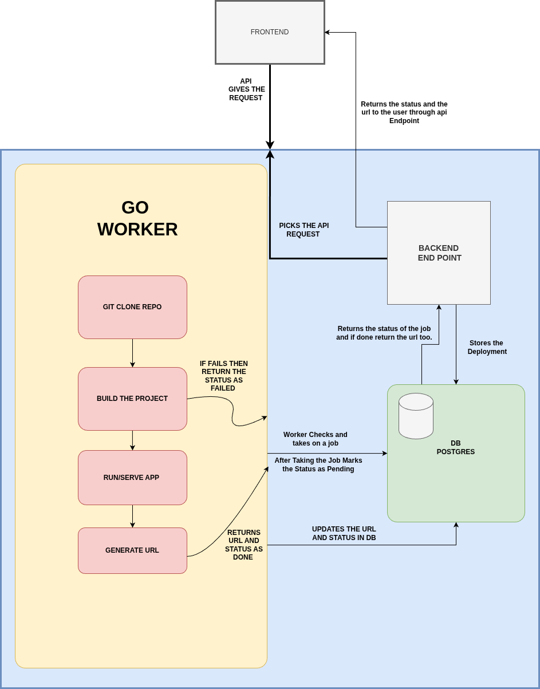

# Arthur: Backend

Arthur is a Vercel-style deployment platform for static sites. Connect a GitHub repository, and Arthur clones it, builds it inside a locked-down Docker container, stores the output in S3, and serves it on a stable subdomain. Every push to the tracked branch can trigger a new deployment, and any earlier successful deployment can be promoted back to live (rollback) without rebuilding.

This directory contains the Go API and the build worker. The dashboard lives in a separate frontend.



## Features

- **GitHub login** (OAuth with state check) plus email/password, with HttpOnly cookie sessions and refresh-token rotation
- **Deployments from GitHub**: manual deploys, redeploys, and push webhooks (HMAC-verified)
- **Sandboxed builds**: each install/build step runs in a `node:24` container with memory, CPU and PID limits, all Linux capabilities dropped, a non-root user, and per-step and whole-deployment timeouts
- **Encrypted project environment variables** (AES-256-GCM at rest), injected into builds through a temp env file and redacted from build logs
- **Stable project URLs and rollback**: `<project-slug>.<domain>` always serves the active deployment; every deployment also keeps an immutable permalink
- **Log streaming by polling**: cursor-based endpoint, so a dashboard only fetches new lines
- **Stuck-job recovery**: a reaper marks builds stuck after a worker crash as failed

## How it works

1. The API stores a deployment as `queued` in Postgres.
2. The worker claims jobs with `SELECT ... FOR UPDATE SKIP LOCKED`, so multiple workers never take the same job.
3. The worker shallow-clones the tracked branch, then runs the install and build commands in a resource-limited container.
4. The build output directory is uploaded to a private S3 bucket under `<deploymentID>/`.
5. The deployment is marked `success` and becomes the project's active deployment.
6. A request to `<slug>.<site domain>` is resolved by the API: project slug, then active deployment, then the file is streamed from S3. A 12-character deployment prefix serves that exact deployment (permalink).

Rollback is just changing which successful deployment is active. Nothing is rebuilt, since every deployment's files remain in S3.

## Stack

Go, chi, PostgreSQL, sqlc, goose, Docker, AWS S3, GitHub OAuth and webhooks.

## Getting started

### Prerequisites

- Go 1.26+
- Docker (the worker runs builds with `docker run`; the user running the worker must be able to use Docker without sudo)
- PostgreSQL 14+
- [goose](https://github.com/pressly/goose) for migrations and [sqlc](https://sqlc.dev) only if you change the SQL
- An AWS S3 bucket (private) and credentials that can read and write it
- A GitHub OAuth App (callback URL: `http://localhost:8080/v1/auth/github/callback`)

### Setup

```bash
# 1. Configure
cp .env.example .env        # then fill in the values

# 2. Start Postgres (or use your own)
docker run -d --name arthur-db -p 5432:5432 \
  -e POSTGRES_PASSWORD=postgres -e POSTGRES_DB=arthur postgres:16

# 3. Run migrations
goose -dir sql/schema postgres "$DB_URL" up

# 4. Run the API and the worker (two terminals, from this directory)
go run ./cmd/api
go run ./cmd/worker
```

The API listens on `PORT` (default 8080). Deployed sites are served by the same process on subdomains, for example `http://my-site-a1b2.localhost:8080` (browsers resolve `*.localhost` automatically).

### Receiving GitHub webhooks locally

GitHub can't reach `localhost`. Expose the API with a tunnel (for example `cloudflared tunnel --url http://localhost:8080`), then add a webhook to your repository:

- Payload URL: `https://<tunnel-host>/v1/github/webhook`
- Content type: `application/json`
- Secret: the value of `GITHUB_WEBHOOK_SECRET`
- Events: just the push event

## Configuration

All configuration is through environment variables. See [`.env.example`](.env.example) for the full annotated list.

| Variable | Purpose |
| --- | --- |
| `PORT` | API port |
| `DB_URL` | Postgres connection string |
| `FRONTEND_URL` | Dashboard origin (CORS allow-list and post-login redirect) |
| `JWT_SECRET` | Signs access tokens |
| `COOKIE_SECURE` | `true` in production so cookies are HTTPS-only |
| `GITHUB_CLIENT_ID`, `GITHUB_CLIENT_SECRET`, `GITHUB_CALLBACK_URL` | GitHub OAuth App |
| `GITHUB_WEBHOOK_SECRET` | Verifies push webhooks (requests are rejected if unset) |
| `ENV_ENCRYPTION_KEY` | Base64 32-byte key for encrypting project env vars |
| `AWS_REGION`, `AWS_ACCESS_KEY_ID`, `AWS_SECRET_ACCESS_KEY`, `AWS_BUCKET_NAME` | S3 storage for build output |
| `SITE_SCHEME`, `SITE_BASE_DOMAIN` | How public site URLs are built (`http` + `localhost:8080` locally) |

## API

All routes are under `/v1`. Routes marked **auth** require the session cookie.

| Method | Path | Auth | Description |
| --- | --- | --- | --- |
| GET | `/healthz` | | Readiness check |
| POST | `/auth/register`, `/auth/login` | | Email/password auth, sets session cookies |
| GET | `/auth/github/login`, `/auth/github/callback` | | GitHub OAuth flow |
| POST | `/auth/refresh`, `/auth/logout` | | Rotate refresh token / clear session |
| GET | `/auth/me` | yes | Current user |
| POST | `/projects` | yes | Create a project (returns `slug`, `url`) |
| POST | `/projects/{id}/redeploy` | yes | Queue a new deployment |
| GET | `/projects/{id}/deployments` | yes | Deployments with `project_url` and `is_active` |
| POST | `/projects/{id}/deployments/{deploymentID}/promote` | yes | Roll back / forward to a successful deployment |
| GET, PUT | `/projects/{id}/env` | yes | List / set encrypted environment variables |
| DELETE | `/projects/{id}/env/{key}` | yes | Delete one environment variable |
| POST | `/deployments` | yes | Create a deployment |
| GET | `/deployments/{id}` | yes | Deployment status |
| GET | `/deployments/{id}/logs?after=<seq>` | yes | New log lines since `seq`, plus `status`, `next_after`, `done` |
| POST | `/github/webhook` | signature | Push events trigger deployments |

Polling logs: start with `after=0`, send back `next_after` each time, and stop when `done` is `true`.

## Security notes

- Build commands are user-controlled, so they run only inside a container: memory/CPU/PID limits, `--cap-drop ALL`, `no-new-privileges`, non-root user, timeouts. User env vars are passed with `--env-file`, never into the worker's own environment.
- Repository URLs must be `https://` without embedded credentials; `git clone` runs with `GIT_ALLOW_PROTOCOL=https`, `--` before arguments, and no credential prompt.
- Webhook payloads are verified with HMAC-SHA256 before anything is parsed, and rejected if no secret is configured.
- Cookies are HttpOnly and SameSite=Lax; the refresh cookie is scoped to `/v1/auth`. Refresh tokens are stored hashed and rotated.
- Logs and deployments are only readable by the project's owner.
- Static-site build variables end up in the public bundle (like any static host), so don't put secrets in them.

## Project layout

```
cmd/api          HTTP API and site serving
cmd/worker       job runner (build pipeline) and stuck-job reaper
internal/
  auth           JWT, cookies, refresh tokens, middleware
  builder        git clone, docker build steps, env file handling
  config         DB connection and shared config helpers
  crypto         AES-256-GCM for project env vars
  database       sqlc-generated queries
  deployment     the deployment pipeline
  handlers       HTTP handlers
  logs           deployment log writer
  models         API response types
  siteurl        public site URL builder
  storage        S3 upload and download
sql/schema       goose migrations
sql/queries      sqlc queries
Architecture     diagrams
```

After editing `sql/queries` or `sql/schema`, run `sqlc generate`.

## Tests

```bash
go test ./...
```

Covers encryption round-trips, secret redaction, slug and repository URL validation, site URL building and webhook signature verification.

## Known limitations

- Static sites only (build, then serve the output directory); no long-running server apps.
- Builds run in containers on the worker host with a shared network; there is no network isolation during builds yet. Run it with signup restricted to people you trust until that is added.
- Single worker host, no autoscaling.
- No custom domains and no preview deployments for pull requests.